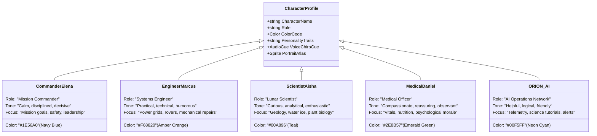
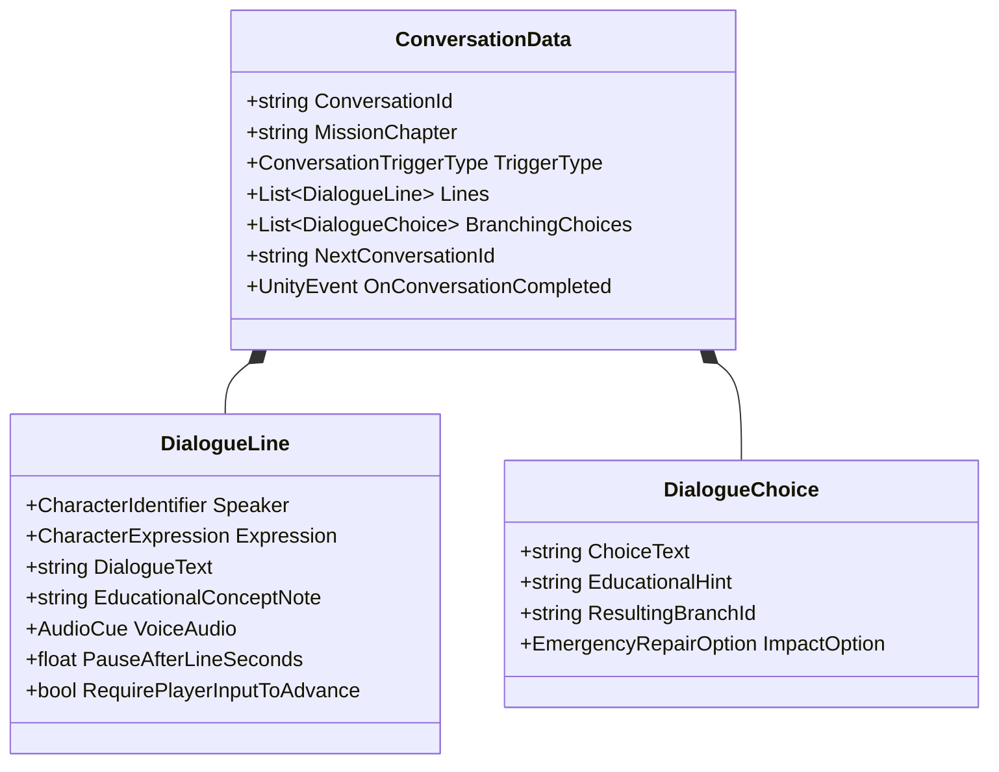

# OUTPOST: SURVIVE BEYOND EARTH
## SYSTEM 3 – DIALOGUE AND CONVERSATION ARCHITECTURE
**Project**: Outpost: Survive Beyond Earth  
**Development Target**: Mission 1 – The First Frontier (Lunar South Pole, 2045)  
**Target Engine**: Unity with URP (Universal Render Pipeline)  
**Platform**: Unity WebGL (Target Audience: Children aged 7–12)  
**Document**: Dialogue & Narrative Presentation Specification (`Documentation/DialogueArchitecture.md`)  

---

### 1. Narrative & Educational Foundations

*Outpost: Survive Beyond Earth* is a 3D survival and educational simulation designed to inspire children aged 7–12 with authentic space exploration principles. Set at the **Lunar South Pole in the year 2045**, Mission 1 documents the establishment of humanity's first permanent lunar habitat. 

The dialogue system serves as the primary educational and storytelling engine. It seamlessly balances scientific facts (lunar regolith, water ice electrolysis, closed-loop life support, solar radiation) with high-stakes teamwork, empathy, and problem-solving inspired by historical space milestones like **Apollo 13**.

---

### 2. Character Dossiers & Dialogue Profiles

Every character has a distinct vocal cadence, color identity, and emotional range tailored for young audiences:

---

### 3. Dialogue Data Architecture & ScriptableObjects

Dialogue structures are authored as modular Unity **ScriptableObjects** (`Assets/Data/Conversations/`). This empowers mission designers to create branching dialogue without modifying code.

#### Expression & Emotion States
Portraits dynamically switch between 6 child-friendly expressive states:
1. `Neutral`: Standard relaxed communication.
2. `Happy`: Celebrating milestones, successful repairs, and discoveries.
3. `Concerned`: Recognizing equipment faults, low resources, or storm warnings.
4. `Determined`: Preparing for EVA repairs or tackling the filtration challenge.
5. `Serious`: Critical emergency briefings and commander orders.
6. `Alert`: Immediate hazard response (ORION warning strobe, alarm state).

---

### 4. Conversation Modes & Interaction Patterns

#### A. Two-Character Conversations
Intimate interactions between the player and a single astronaut, or between two crew members observed by the player.
- *Example*: Marcus explaining battery discharge limits to Elena while inspecting the solar array.

#### B. Multi-Character Conversations (Crew Briefings)
Full-crew conferences around the habitat central table or over habitat intercom.
- The UI highlights the active speaker's portrait while keeping other crew members visible in thumbnail format with their current emotion state.

#### C. Character-to-Character Autonomous Comms
Characters communicate with one another independently of player actions, creating a living, breathing lunar outpost.
- *Example*: Aisha radioing Daniel: *"Daniel, the hydroponic lettuce has sprouted two days ahead of schedule! The LED spectrum adjustment worked."*

#### D. Pre-Event Briefings
Mandatory narrative checkpoints preceding hazards or emergencies.
- Ensures children understand the upcoming objective and stakes before timers or puzzles engage.

#### E. Branching Player Choices (Decision Consequences)
In Chapter 6, the player is presented with three distinct solutions:
1. **Astronaut EVA Repair (Elena)**: Fast restore, consumes suit oxygen, moderate risk.
2. **Robotic Maintenance (Marcus & ORION)**: Preserves astronaut safety, consumes high power reserves.
3. **Power Conservation & Delayed Repair (Daniel & Aisha)**: Conserves battery, temporarily limits station heating.

---

### 5. Mission 1 Storyline & Educational Dialogue Script

#### Chapter 1 – Arrival on the Moon
- **Setting**: Shackleton Rim Landing Zone. Lunar dawn.
- **Story**: The lander engine settles. The crew conducts initial checks and activates ORION.
- **Elena**: *"Base command, this is Commander Elena. The Outpost lander has touched down at the Lunar South Pole. All four crew members are safe."*
- **Marcus**: *(Humorous/Relieved)* *"And my favorite wrench survived the flight without a scratch. Let's get these systems running before our batteries get cold."*
- **Aisha**: *(Enthusiastic)* *"Look out the observation viewport! That crater rim has sunlight right now, but inside the shadow... there could be millions of tons of pure water ice!"*
- **Daniel**: *"Heart rates are steady. Welcome to our new home, team. Remember: lunar gravity is only one-sixth of Earth's, so take your first steps slowly!"*
- **ORION**: *(Pleasant chime)* *"Greetings, crew. I am ORION: Onboard Robotic Intelligence and Operations Network. Habitat life-support telemetry is online. Welcome to the Moon."*
- **Educational Concept**: **Lunar Gravity (1/6g)** and **Permanently Shadowed Regions (PSRs)**.

#### Chapter 2 – Establishing the Outpost
- **Story**: Connecting the solar array, water recycling unit, and greenhouse.
- **Marcus**: *"Connecting the high-efficiency photovoltaic array to the main power bus. Elena, we're generating 45 kilowatts. Nominal!"*
- **Aisha**: *"Initiating the water electrolysis chamber. We're splitting recycled water molecules into breathable oxygen ($O_2$) and hydrogen fuel ($H_2$)."*
- **Daniel**: *"Greenhouse temperature is stabilizing at 21 degrees Celsius. Hydroponic moisture sensors are green."*
- **Elena**: *"Outstanding work. ORION, log our station status: Outpost 1 is officially operational."*
- **Educational Concept**: **Electrolysis of Water ($2H_2O \to 2H_2 + O_2$)** and **Hydroponics**.

#### Chapter 3 – The First Warning
- **Story**: ORION detects a coronal mass ejection (solar flare) and incoming space debris.
- **ORION**: *(Caution alert chime)* *"Caution: Deep space weather sensors detect elevated solar proton flux. An unexpected micrometeoroid cloud is approaching Sector 3."*
- **Elena**: *"Crew, helmet check! All personnel retreat to the reinforced habitat core. Marcus, what's our external equipment status?"*
- **Marcus**: *(Concerned)* *"Exterior cameras are shaking! Hold on—we just felt a tremor!"*
- **ORION**: *(Red alert pulse)* *"Warning: Micrometeoroid impact confirmed on external power conduit. Primary electrical line to Life Support Substation 2 is severed."*
- **Educational Concept**: **Solar Weather, Micrometeoroids**, and lack of lunar atmosphere protection.

#### Chapter 4 – The Life-Support Emergency
- **Story**: Power interruption halts the primary carbon dioxide scrubbers and oxygen blowers.
- **Daniel**: *(Observant/Urgent)* *"Elena, the atmospheric analyzer is chiming! Carbon dioxide ($CO_2$) levels are rising in the living quarters. The main scrubbers have stopped cycling!"*
- **Aisha**: *"Without electricity to the main air processor, we can't remove the $CO_2$ we're exhaling. We have under forty minutes before crew focus deteriorates."*
- **Marcus**: *"The spare scrubber parts are incompatible—the backup module has round filter canisters, but our habitat slots are square!"*
- **Elena**: *"Keep calm, everyone. Space explorers have solved this before. We work together, step by step."*
- **Educational Concept**: **Carbon Dioxide Poisoning** and the necessity of closed-loop gas scrubbing.

#### Chapter 5 – The Filtration Challenge (Historical Apollo 13 Inspiration)
- **Story**: The crew engineers an emergency adapter using available outpost materials.
- **Elena**: *"ORION, display historical mission logs from Apollo 13, April 1970."*
- **ORION**: *"Accessing archive. In 1970, Apollo 13 astronauts used a suit hose, cardboard flight manual covers, and gray duct tape to adapt square lithium hydroxide canisters to a round socket."*
- **Marcus**: *(Grinning)* *"Duct tape! The greatest invention in human spaceflight history. Aisha, grab the flexible thermal hoses from the rover maintenance kit!"*
- **Aisha**: *"I have the spare plastic sample bags and rigid manual covers. Daniel, help me measure the seal diameter."*
- **Daniel**: *"Pressure seal is tight. If we reroute auxiliary battery pack B, we can power the small blower fan."*
- **Player Interaction**: Interactive mini-game / puzzle where players match the materials and secure the emergency filter adapter.
- **Educational Concept**: **Creative Engineering Problem-Solving** and **Lithium Hydroxide ($LiOH$) Filters**.

#### Chapter 6 – Save the Outpost (Player Decision)
- **Story**: Restoring the main power grid to stabilize the station long-term.
- **ORION**: *"Emergency filtration is temporary. Permanent power must be restored to Substation 2. Three operational paths are available."*
- **Dialogue Choice Displayed to Player**:
  1. **Option A (Commander Elena)**: *"I will suit up for an EVA repair. I can splice the severed cable manually in 15 minutes."*
     - *Hint: Fastest fix; tests player EVA navigation.*
  2. **Option B (Marcus & Aisha)**: *"Let's deploy the automated robotic rover with the manipulator arm to weld the conduit."*
     - *Hint: 100% safe for crew; requires precise remote driving.*
  3. **Option C (Daniel & ORION)**: *"Reroute secondary power through the greenhouse auxiliary line and reduce habitat lighting."*
     - *Hint: No EVA required; requires careful power budget balancing.*
- **Outcome**: Each branch provides rich educational feedback and culminates in restored station power.

#### Chapter 7 – A New Beginning
- **Story**: System restoration, crew debrief, and celebration.
- **ORION**: *"Power grid restored to 100%. Carbon dioxide scrubbers nominal: 450 ppm. All station systems green."*
- **Elena**: *"Team, that was exceptional teamwork under pressure. You proved that humans and technology together can survive beyond Earth."*
- **Daniel**: *"Crew health check complete: heart rates normal, zero injuries, 100% morale."*
- **Marcus**: *"And best of all, the greenhouse strawberries are still safe and sound!"*
- **Aisha**: *"Mission 1 is a success. Next stop: exploring the ice caves of Shackleton Crater!"*
- **Educational Concept**: **Resilience, Teamwork**, and humanity's sustainable future on the Moon.

---

### 6. Subtitle & Voice Presentation Rules (Ages 7–12)

1. **Reading Speed Budget**: 30 to 35 characters per second default. Never auto-advance without player tap/click unless cinematic letterbox mode is active.
2. **Text Presentation**: Large, friendly typography with heavy letter spacing. Key educational keywords (e.g., **Electrolysis**, **Regolith**, **Solar Flare**) appear highlighted in energetic yellow (`#FFD166`) with clickable explanation glossaries.
3. **Voice Audio Chimes**: Even when full voice acting is absent, every character speaks with distinct synthesized radio chirp sounds (dynamic pitch, tempo, and robotic filters) to keep young players engaged and attentive.
