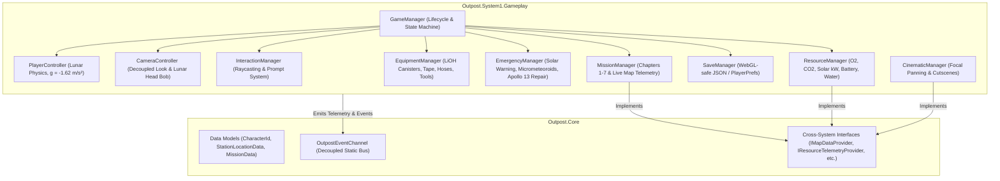

# OUTPOST: SURVIVE BEYOND EARTH
## System 1: Gameplay Architecture Specification (Mission 1)

### 1. Executive Summary
This document specifies the rebuilt, optimized gameplay architecture for **OUTPOST: SURVIVE BEYOND EARTH – Mission 1: The First Frontier**. Designed by the Lead Gameplay Programmer (System 1), the architecture is engineered for browser-based **Unity WebGL**, maintaining 60 FPS performance, low garbage collection overhead, decoupled event-driven communication, and rigorous separation of concerns.

---

### 2. Core Architecture Diagram

---

### 3. Detailed Subsystem Specifications

#### 1. GameManager (`Assets/Outpost/System1_Gameplay/Core/GameManager.cs`)
- **Role**: Central gameplay coordinator and lifecycle state machine.
- **States**:
  - `Initializing`: Subsystem boot and reference discovery.
  - `LandedArrival`: Chapter 1 touchdown at Landing Zone Orion-1.
  - `OutpostEstablishment`: Chapter 2 station module startup.
  - `SolarWarning`: Chapter 3 coronal mass ejection detection.
  - `EmergencyLifeSupport`: Chapter 4 micrometeoroid impact & CO2 buildup.
  - `FiltrationPuzzle`: Chapter 5 Apollo 13 canister adaptation puzzle.
  - `StrategicDecision`: Chapter 6 EVA vs Robotic Arm vs Conservation choice.
  - `MissionComplete`: Chapter 7 recovery and celebration.
  - `Paused`: Modal or user pause ($Time.timeScale = 0$, input lock).
- **Controls Locking**: Automatically enables/disables character movement and mouse cursor lock when menus, Geo Map, or puzzles open.

#### 2. PlayerController (`Assets/Outpost/System1_Gameplay/Player/PlayerController.cs`)
- **Role**: Astronaut locomotion in low lunar gravity.
- **Physics**:
  - $g_{\text{moon}} = -1.62\,\text{m/s}^2$ (strictly matching lunar physics).
  - Buoyant low-gravity leap ($h = 2.2\,\text{m}$, $v_0 = \sqrt{2 \cdot |g| \cdot h} \approx 2.67\,\text{m/s}$).
  - Vacuum air inertia factor ($0.85$ damping) allowing realistic low-gravity gliding.
- **Suit Stamina**: Oxygen stamina consumption during sprinting ($12\,\text{units/sec}$) with automatic metabolic regeneration.
- **Surface Footsteps**: Procedural audio cadence triggered by surface contact and speed.

#### 3. CameraController (`Assets/Outpost/System1_Gameplay/Player/CameraController.cs`)
- **Role**: First-person perspective, mouse look, and cinematic blending.
- **Features**:
  - Decoupled from movement physics to eliminate jitter.
  - Smooth look dampening with vertical clamp ($-80^\circ$ to $+80^\circ$).
  - Lunar head bobbing with realistic low-frequency oscillation ($3.5\,\text{Hz}$).
  - Cinematic target override supporting smooth interpolation toward anchors requested by `ICinematicTrigger`.

#### 4. InteractionManager (`Assets/Outpost/System1_Gameplay/Interactions/InteractionManager.cs`)
- **Role**: Event-driven raycasting and interactive target execution.
- **Features**:
  - Distance threshold ($3.5\,\text{m}$) checking for objects implementing `IInteractable`.
  - Dispatches `OnInteractableTargetChanged` and updates HUD prompts.
  - Executes interactions on `[E]` key press.
  - Handles Geo Map modal toggle on `[M]` key press.

#### 5. ResourceManager (`Assets/Outpost/System1_Gameplay/Resources/ResourceManager.cs`)
- **Role**: Outpost consumable simulation and life-support telemetry.
- **Consumables Simulated**:
  - **Oxygen ($O_2$)**: $99.2\%$ nominal, drops to $82\%$ during emergency, recovers upon repair.
  - **Carbon Dioxide ($CO_2$)**: $420\,\text{ppm}$ nominal, climbs to $1650\,\text{ppm}$ when scrubbers fail, scrubbed down by LiOH adapter.
  - **Solar Power Generation**: $50\,\text{kW}$ nominal, drops to $8\,\text{kW}$ on relay severance, restored to $52\,\text{kW}$ on circuit repair.
  - **Battery Storage**: $95\%$ nominal, discharges under emergency load, recharges when solar generation exceeds load.
  - **Water Reserves**: $850\,\text{L}$ closed loop ($98\%$ recovery rate).
  - **Greenhouse Biomass**: $78\%$ hydroponic vegetable health.
- **Interfaces**: Implements both `IResourceTelemetryProvider` (for Computer 3's HUD) and `ILifeSupportSystem`.

#### 6. EquipmentManager (`Assets/Outpost/System1_Gameplay/Equipment/EquipmentManager.cs`)
- **Role**: Astronaut equipment inventory and tool management.
- **Items**:
  1. `Square LiOH Canister`: Replacement carbon dioxide absorption canister.
  2. `Heavy-Duty Space Tape`: High-tensile grey duct tape.
  3. `Suit Umbilical Hose`: Flexible airflow ducting from EVA suits.
  4. `Flight Manual Cover`: Stiff cardboard manual cover used as adapter funnel.
  5. `High-Voltage Cable Splicer`: Marcus's electrical relay repair tool.
  6. `Rover Wireless Terminal`: Remote robotic manipulator arm control.
  7. `Cryogenic Core Drill`: Aisha's sampling drill for crater water-ice.

#### 7. EmergencyManager (`Assets/Outpost/System1_Gameplay/Emergency/EmergencyManager.cs`)
- **Role**: Coordinates narrative disaster and repair sequences.
- **Sequence**:
  - `SolarActivityWarning` (Chapter 3)
  - `MicrometeoroidImpact` & `LifeSupportFailure` (Chapter 4)
  - `FiltrationAssembly` puzzle (Chapter 5)
  - `StrategicRepairPending` decision (Chapter 6)
  - `FullyResolved` (Chapter 7)

#### 8. MissionManager (`Assets/Outpost/System1_Gameplay/Mission/MissionManager.cs`)
- **Role**: Mission 1 progression and live map data telemetry.
- **Story Chapters**: Full support for Chapters 1 through 7.
- **Map Provider**: Implements `IMapDataProvider`, feeding real player world coordinates, active waypoint coordinates, and discovery states to Computer 3's Geo Map.

#### 9. DialogueEvent Integration
- **Role**: Connects chapter milestones and crew interactions to Computer 3's `DialogueUI` and `AutonomousCrewDialogue`.
- Broadcasts via `OutpostEventChannel.RaiseDialogueLinePrompted()` and `RaiseDialogueCompleted()`.

#### 10. Character Interaction Integration
- **Role**: Bridges player interaction directly with crew member anchors (`CrewVisualAnchor` and `ICrewCharacter`), initiating contextual spoken dialogue with Elena, Marcus, Aisha, Daniel, and ORION.

#### 11. Map Location and Waypoint Data
- **Role**: Supplies the 10 canonical lunar station coordinates to the Geo Map. Both 3D environment and 2D Geo Map use identical coordinates:
  1. Main Habitat Alpha: $(0, 0, 0)$
  2. Landing Zone Orion-1: $(-120, 0, -80)$
  3. Solar Array Ridge: $(100, 15, 60)$
  4. Hydroponic Greenhouse: $(35, 0, 20)$
  5. Geology & Research Lab: $(-40, 0, 30)$
  6. Deep Space Comms Tower: $(140, 30, -50)$
  7. Rover Dock & Recharger: $(-60, 0, -35)$
  8. EVA Equipment & Storage: $(20, 0, -50)$
  9. Shackleton Crater Ice Field: $(-180, -10, 110)$
  10. Emergency Relay Junction: $(85, 12, 45)$

#### 12. SaveManager (`Assets/Outpost/System1_Gameplay/Persistence/SaveManager.cs`)
- **Role**: WebGL-safe state persistence.
- Serializes chapter progress, repair choices, player coordinates, and life-support telemetry to JSON and stores in `PlayerPrefs`. Automatically saves upon each chapter transition.

#### 13. Audio and Event Integration
- **Role**: Synthesized sound effects triggered by gameplay actions:
  - `"radio_chirp"`, `"lunar_hop"`, `"alarm_siren"`, `"terminal_beep"`, `"waypoint_reached"`, `"victory_chime"`, `"sample_scan"`, `"interact"`.
- Communicated to Computer 3's `OutpostAudioSynthesizer` via `OutpostEventChannel.RaisePlaySfx()`.

---

### 4. Performance Guidelines for Unity WebGL
1. **Zero Garbage Collection in Update Loops**: All telemetry ticks run on configurable 1.0s timers rather than per-frame allocations.
2. **Decoupled Event Bus**: Direct delegate invocations via static `OutpostEventChannel` avoid expensive `SendMessage` or `FindObjectsOfType` calls.
3. **Optimized Physics**: Uses Unity's lightweight `CharacterController` with analytical lunar gravity integration, minimizing PhysX overhead.
4. **Fast Assembly Builds**: System 1 compiles as an independent assembly (`Outpost.System1.Gameplay.asmdef`), speeding up incremental WebGL iteration.
