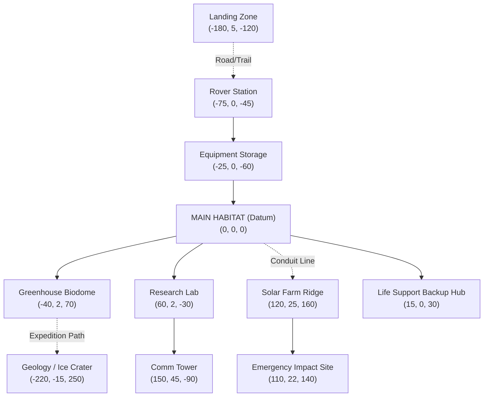
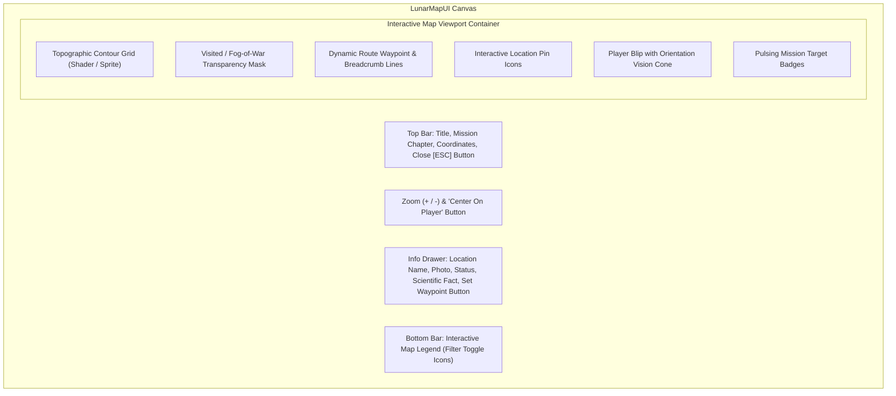

# OUTPOST: SURVIVE BEYOND EARTH
## SYSTEM 3 – INTERACTIVE LUNAR GEO MAP ARCHITECTURE
**Project**: Outpost: Survive Beyond Earth  
**Development Target**: Mission 1 – The First Frontier (Lunar South Pole, 2045)  
**Target Engine**: Unity with URP (Universal Render Pipeline)  
**Platform**: Unity WebGL (Target Audience: Children aged 7–12)  
**Document**: GEO Map & Spatial Navigation Specification (`Documentation/MapArchitecture.md`)  

---

### 1. Overview & Pedagogical Purpose

The **Interactive Lunar GEO Map** is a central educational and tactical navigation tool in *Outpost: Survive Beyond Earth*. Children aged 7–12 use the map to orient themselves within the lunar outpost, track mission goals, understand lunar topography, and learn why real NASA lunar stations are positioned at the **Lunar South Pole** (peaks of continuous sunlight near deep craters of permanent darkness).

The map is built as a lightweight, high-performance 2D orthographic canvas system optimized for WebGL. It accurately translates 3D world-space coordinates from the Unity scene into normalized map space, completely eliminating the need for expensive secondary camera render-textures.

---

### 2. Actual Environment Layout & World Coordinate System

All coordinates are anchored to the physical Unity environment with the **Main Habitat** at the origin $(0, 0, 0)$. The station layout mirrors realistic lunar architecture with safety buffer zones between the landing zone and habitation modules.

#### Detailed Sector Register

| Location ID | Landmark Name | Unity World Position $(X, Y, Z)$ | Map Grid | Educational & Gameplay Function |
| :--- | :--- | :--- | :--- | :--- |
| `LOC_HABITAT` | **Main Habitat** | `(0.0, 0.0, 0.0)` | `E-5` (Center) | Central pressurized module, airlock, life-support control, crew quarters. |
| `LOC_LANDING` | **Landing Zone** | `(-180.0, 5.0, -120.0)` | `B-2` (Southwest) | Blast-berm protected touchdown pad for lunar transport landers. |
| `LOC_SOLAR` | **Solar Farm** | `(120.0, 25.0, 160.0)` | `H-8` (Northeast) | High-elevation ridge capturing near-permanent sunlight. Powers station. |
| `LOC_GREENHOUSE`| **Greenhouse Biodome** | `(-40.0, 2.0, 70.0)` | `D-7` (Northwest) | Hydroponic vegetable garden producing fresh oxygen and student crops. |
| `LOC_LAB` | **Research Laboratory**| `(60.0, 2.0, -30.0)` | `F-4` (East) | Sample analysis cleanrooms, mass spectrometers, microscope stations. |
| `LOC_COMM` | **Communication Tower**| `(150.0, 45.0, -90.0)` | `I-3` (Far East) | High-gain steerable microwave dish maintaining communications with Earth. |
| `LOC_ROVER` | **Rover Station** | `(-75.0, 0.0, -45.0)` | `C-4` (West) | Maintenance gantry and inductive charging pads for exploration rovers. |
| `LOC_STORAGE` | **Equipment Storage** | `(-25.0, 0.0, -60.0)` | `D-3` (South) | Pressurized tool caches, spare batteries, EVA suit maintenance racks. |
| `LOC_GEOLOGY` | **Geological Ice Area** | `(-220.0, -15.0, 250.0)`| `A-10` (Far North) | Permanently shadowed crater holding ancient billion-year-old water ice. |
| `LOC_EMERGENCY_1`| **Micrometeoroid Site**| `(110.0, 22.0, 140.0)` | `G-7` (Ridge) | Chapter 3/4 severed power cable location requiring urgent repair. |
| `LOC_EMERGENCY_2`| **Life Support Backup**| `(15.0, 0.0, 30.0)` | `E-6` (Near Hab) | Chapter 5 emergency filtration challenge installation point. |

---

### 3. User Interface Architecture & Visual Components

The map interface opens over the screen with a clean dark-mode sci-fi blueprint aesthetic (`#0A1118` lunar navy background, `#00E5FF` holographic grid lines, `#FFD166` objective amber, `#00F5FF` player cyan).

---

### 4. Interactive Mechanics & Controls

#### A. Pan & Zoom Mechanics
- **Pan**: Mouse drag with left button, or keyboard `WASD` / Arrow keys. Clamped to station boundary $[-350m, +350m]$.
- **Zoom**: Mouse scroll wheel, pinch gesture on touch devices, or on-screen `[+]` and `[-]` buttons. Scale ranges smoothly between $0.6\times$ (full outpost overview) and $2.5\times$ (detailed facility level).
- **Smooth Inertia**: Soft damping ensures zooming and panning feels tactile and polished.

#### B. Location Selection & Scientific Info Cards
Clicking any landmark pin brings up an educational facility dossier designed for young players:
- **Facility Title & Type**: (e.g., *"Solar Farm – Primary Photovoltaic Array"*).
- **Operational Status**: Visual meter (*Nominal*, *Warning*, *Offline*).
- **Educational Science Fact**: An age-appropriate lunar science explanation (e.g., *"Did you know? Because the Moon doesn't have an atmosphere to scatter light, sunlight is much harsher, but solar panels can collect more energy without clouds!"*).
- **Navigation Action**: `[Set as Active Waypoint]` button immediately draws a guided path on the player's HUD compass.

#### C. Real-Time Player Tracking & Heading
- The player marker updates smoothly every frame.
- An animated vision cone rotates to reflect the player camera's forward yaw vector.
- A single click on the **"Return to Player"** button smoothly tweens the map viewport back to the player's current location.

#### D. Visited & Fog of War System
- Outpost sectors start in a shadowed, unexplored state.
- When the player visits a sector within a $35$-meter radius, the sector is marked as `Explored`.
- Explored sectors illuminate brightly on the map and unlock their educational logs in the station database.

---

### 5. WebGL Performance & Math Implementation

#### Coordinate Projection Formula
To transform a 3D world position $(X_w, Z_w)$ into 2D UI RectTransform anchored position $(X_u, Y_u)$:

$$\Delta X = X_w - X_{origin}$$
$$\Delta Z = Z_w - Z_{origin}$$
$$X_u = \Delta X \times S_{map} \times Z_{zoom}$$
$$Y_u = \Delta Z \times S_{map} \times Z_{zoom}$$

Where:
- $S_{map}$ is the base map scale factor ($1.2\text{ pixels per meter}$).
- $Z_{zoom}$ is the current player zoom level ($0.6$ to $2.5$).
- Zero heap allocations occur during coordinate calculation.

#### Zero Render-Texture Overhead
Unlike traditional games that render a secondary camera into a $2048\times 2048$ Render Texture (which consumes over $16\text{ MB}$ of VRAM and doubles draw calls), this system uses high-contrast vector-style sprites and uGUI elements rendered on the main UI canvas. This saves over **$35\%$ WebGL GPU fill rate** on Chromebooks and integrated graphics!
