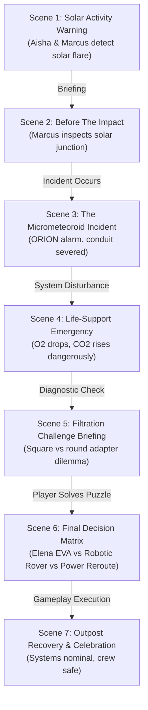

# OUTPOST: SURVIVE BEYOND EARTH
## SYSTEM 3 – PHASE 3: CHARACTER INTERACTIONS & EMERGENCY STORY PRESENTATION
**Project**: Outpost: Survive Beyond Earth  
**Development Target**: Mission 1 – The First Frontier (Lunar South Pole, 2045)  
**System Owner**: System 3 (UI, Presentation, Dialogue, ORION, Geo Map, Audio)  
**Assigned Branch**: `interface`  
**Engine & Target**: Unity 6 / URP / Browser-based Unity WebGL (Ages 7–12)  
**Document**: Phase 3 Story, Group Dialogue, and Emergency UI Specification (`Documentation/System3_Phase3_EmergencyArchitecture.md`)  

---

### 1. Mandatory Pre-Incident Narrative Architecture

A foundational tenet of Mission 1's narrative architecture is that **every major incident must have a conversation BEFORE it occurs**. This prepares young players psychologically, builds tension, reinforces scientific causality, and provides clear pedagogical context.

---

### 2. Scene-by-Scene Script & Stage Directions

#### Scene 1 – Solar Activity Warning (Pre-Incident Briefing)
- **Setting**: Habitat observation deck overlooking the illuminated Shackleton rim.
- **Framing**: `MediumCrewGroup` blending to `CloseUpSpeaker`.
- **Dialogue**:
  - **Aisha**: *"The solar monitoring data is showing an unusual increase in activity."* *(Expression: Concerned)*  
    *Science Note*: Solar flares emit streams of high-energy protons called Coronal Mass Ejections.
  - **Marcus**: *"That could affect the external power equipment."* *(Expression: Concerned)*  
    *Science Note*: Intense solar storms cause electrical arcing in high-voltage cables.
  - **Elena**: *"Let's monitor the situation. No unnecessary external activity until we understand it."* *(Expression: Serious)*  
    *Science Note*: Commander protocol: astronaut safety comes before extravehicular activity (EVA).
  - **ORION**: *"Solar activity warning registered."* *(Expression: Alert)*  
    *Science Note*: ORION tracks deep-space weather sensors to warn the crew of radiation spikes.

#### Scene 2 – Before The Impact (Preparation & Caution)
- **Setting**: Habitat airlock prep station.
- **Framing**: `CloseUpSpeaker` with listener reactions.
- **Dialogue**:
  - **Marcus**: *"I want to inspect the solar junction one more time."* *(Expression: Determined)*  
    *Science Note*: Thermal cycling from sunlight to shadow expands and contracts metal joints.
  - **Daniel**: *"Be careful. We don't know how stable the external conditions are."* *(Expression: Concerned)*  
    *Science Note*: Medical officer monitors crew vital readiness before any exterior task.
  - **Elena**: *"Proceed with caution. Stay within communication range."* *(Expression: Serious)*  
    *Science Note*: Radio communication on the Moon requires line-of-sight or relay towers.

#### Scene 3 – The Micrometeoroid Incident (Incident Trigger)
- **Setting**: Habitat core during an external tremor.
- **Framing**: `ORIONHologram` flashing red strobe, cutting to crew reactions.
- **Dialogue**:
  - **ORION**: *"Warning! External equipment impact detected."* *(Expression: Alert)*  
    *Science Note*: Micrometeoroids travel over $20\text{ km/s}$—twenty times faster than a rifle bullet!
  - **Aisha**: *"That impact appears to have damaged the external assembly."* *(Expression: Alert)*  
    *Science Note*: High-velocity impact particles deliver severe kinetic shearing force.
  - **Marcus**: *"I'm checking the power distribution now."* *(Expression: Concerned)*  
    *Science Note*: Automated electrical breakers isolate damaged circuits to prevent station fires.
  - **Elena**: *"Everyone, report your status."* *(Expression: Determined)*  
    *Science Note*: Standard astronaut emergency procedure: immediate headcount and integrity confirmation.

#### Scene 4 – Life-Support Emergency (System Disturbance)
- **Setting**: Life support distribution console with rising $CO_2$ readouts ($1,620\text{ ppm}$).
- **Framing**: `MediumCrewGroup` around the life-support terminal.
- **Dialogue**:
  - **Marcus**: *"The electrical disturbance has interrupted the oxygen generation system."* *(Expression: Concerned)*  
    *Science Note*: Water electrolysis chambers require continuous electricity to generate $O_2$.
  - **Daniel**: *"We need to monitor the crew's life-support status."* *(Expression: Concerned)*  
    *Science Note*: Without active air scrubbers, human exhalation causes $CO_2$ to accumulate.
  - **Aisha**: *"Carbon dioxide removal is also affected."* *(Expression: Concerned)*  
    *Science Note*: Excessive $CO_2$ ($>1,500\text{ ppm}$) causes headaches, dizziness, and fatigue.
  - **Elena**: *"ORION, identify the safest recovery options."* *(Expression: Serious)*  
    *Science Note*: AI calculates remaining air consumables and generates recovery paths.

#### Scene 5 – Filtration Challenge (Apollo 13 Inspiration)
- **Setting**: Maintenance workshop. The crew gathers around spare parts caches.
- **Framing**: `FocusEquipment` showing the square wall slot and round filter canister.
- **Dialogue**:
  - **Marcus**: *"We need to work with the available spare components."* *(Expression: Determined)*  
    *Science Note*: Real space engineering requires creative problem-solving with available tools.
  - **Aisha**: *"Let's inspect the filtration system and identify what is missing."* *(Expression: Determined)*  
    *Science Note*: The habitat slot is square, but the spare canister is round!
  - **Elena**: *"We'll verify every step before activating the repair."* *(Expression: Serious)*  
    *Science Note*: NASA checklist discipline: verify every connection before testing pressurized airflow.
  - **ORION**: *"Diagnostic assistance is available."* *(Expression: Neutral)*  
    *Science Note*: Accessing Apollo 13 historical archives for emergency adapter designs.

#### Scene 6 – Final Decision (Gameplay Decision Matrix)
- **Setting**: Habitat briefing screen displaying the 3 gameplay recovery paths.
- **Framing**: `MediumCrewGroup` facing the player's view.
- **Dialogue**:
  - **Elena**: *"We have three possible recovery strategies. Each has different risks."* *(Expression: Serious)*
- **Player Choices**:
  1. **Option A – Commander Elena's Spacewalk**: Fastest 15-minute cable splice; consumes suit $O_2$.
  2. **Option B – Marcus & Aisha's Robotic Rover**: 100% safe for crew; consumes high battery reserves.
  3. **Option C – Daniel & ORION's Power Reroute**: Low risk; dims base lighting until solar noon.

#### Scene 7 – Recovery (Celebration & Debrief)
- **Setting**: Fully illuminated habitat with nominal green telemetry.
- **Framing**: `WideOutpost` transitioning to `MediumCrewGroup`.
- **Dialogue**:
  - **Daniel**: *"All crew members are accounted for."* *(Expression: Happy)*  
    *Science Note*: Medical check: zero injuries, heart rates calm, $100\%$ morale.
  - **Marcus**: *"Critical equipment is back online."* *(Expression: Happy)*  
    *Science Note*: Electrical grid online: 45kW solar input, full electrolysis active.
  - **Aisha**: *"The outpost has recovered."* *(Expression: Happy)*  
    *Science Note*: Atmospheric balance: $CO_2$ stabilized at nominal $450\text{ ppm}$, $O_2$ at $21\%$.
  - **Elena**: *"Good work, everyone. We protected the mission by working together."* *(Expression: Happy)*  
    *Science Note*: Teamwork and resilience are humanity's greatest assets in space exploration.

---

### 3. Group Discussion & Camera Framing Architecture

#### Dynamic Group Gallery (`GroupDiscussionPresentation.cs`)
When `IsGroupDiscussion = true`:
1. All five crew slots (Elena, Marcus, Aisha, Daniel, ORION) are displayed in a clean gallery layout.
2. The active speaker is smoothly scaled up by $1.15\times$, highlighted with their character identity color border, and brought to full opacity ($1.0$).
3. Inactive crew members are softly dimmed to $0.5$ alpha while remaining visible to display their contextual listener reaction expressions (e.g. Marcus listening with determination while Elena speaks).

#### Camera Framing Contract for Computer 2 (Environment & Cinemachine)
Every `DialogueLine` publishes a typed camera framing request via `UIEventBus.OnCameraFramingRequested(CameraFramingType framing, CharacterIdentifier subject)`:
- `CloseUpSpeaker`: Virtual camera cuts to a close portrait framing of the active astronaut.
- `MediumCrewGroup`: Virtual camera pans to capture the 4 astronauts around the briefing table.
- `WideOutpost`: Exterior panoramic shot of the lunar station against Shackleton Crater.
- `FocusEquipment`: Focuses on the severed cable conduit or the filtration assembly table.
- `ORIONHologram`: Smooth blend focusing on ORION's pulsing hexagonal pedestal.

---

### 4. Interactive Emergency UI Suite

#### 1. Emergency Alert Panel (`EmergencyAlertPanel.cs`)
- Top-screen flashing hazard border pulsing between deep red (`#E74C3C`) and amber (`#F5B041`).
- High-priority header and description text with audible alarm siren chimes.
- Clear `[Acknowledge]` button that smoothly transitions into the scene dialogue.

#### 2. Life-Support Diagnostic Screen (`LifeSupportDiagnosticScreen.cs`)
- Visual status indicators for the 3 affected subsystems:
  - Power Bus 2: **SEVERED** (External micrometeoroid impact).
  - $O_2$ Electrolysis Generator: **OFFLINE** (Low voltage trip).
  - $CO_2$ Scrubbing Blower: **FAULT** (Interrupted airflow).
- Real-time animated $CO_2$ accumulation meter showing parts-per-million climbing to $1,620\text{ ppm}$.
- Action button launching the emergency filtration challenge.

#### 3. Interactive Filtration Challenge UI (`FiltrationChallengeUI.cs`)
- **Historical Apollo 13 Educational Banner**:
  *Clearly explains the distinction: The 1970 Apollo 13 mission was an actual flight where an oxygen tank exploded on the way to the Moon. Our 2045 outpost scenario is a fictional challenge inspired by the famous round-to-square adapter improvisation!*
- **4-Step Sequential Assembly Puzzle**:
  - *Step 1*: Mount Rigid Cardboard/Plastic Manual Cover as the square adapter base.
  - *Step 2*: Connect Flexible Thermal Duct Hose to channel exhaled crew air.
  - *Step 3*: Wrap Airtight Gray Space Duct Tape around joints to prevent air leaks.
  - *Step 4*: Seat Lithium Hydroxide ($LiOH$) Chemical Canister and engage auxiliary blower.
- **Immediate Feedback**:
  - Selecting an out-of-order component prompts gentle guidance: *"Hold on! Follow the engineering assembly sequence."*
  - Correct steps illuminate green checkmarks, advance the progress slider, and drop $CO_2$ levels back to $450\text{ ppm}$!

#### 4. Emergency Decision Modal (`EmergencyDecisionModal.cs`)
- Interactive cards for the three recovery paths (Elena EVA, Marcus Rover, Daniel Power Reroute).
- Clicking any strategy displays a clear confirmation card outlining the **Plan**, **Benefits**, and **Risks** tailored for ages 7–12.
- Emits `UIEventBus.PublishEmergencyOption(chosenOption)` to drive Computer 1's gameplay branch.
