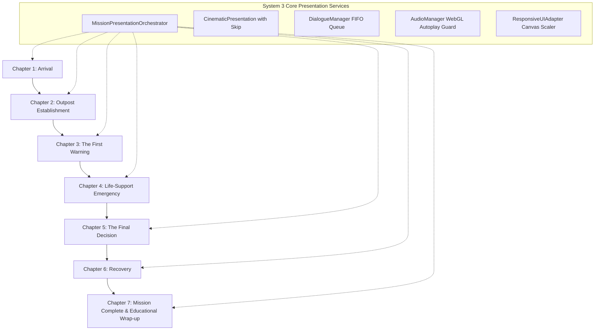

# System 3 — Phase 4: Final Mission 1 Presentation & Polish Architecture

**Project:** OUTPOST: SURVIVE BEYOND EARTH  
**Target:** Mission 1 – The First Frontier (Lunar South Pole, 2045)  
**System:** System 3 (Interface, Audio, Narrative Presentation, and Cinematics)  
**Branch:** `interface`  
**Target Audience:** Children Aged 7–12 (Browser-based Unity WebGL)  

---

## 1. Executive Summary
Phase 4 delivers the complete end-to-end presentation and polish suite for **Mission 1: The First Frontier**, spanning all seven chronological chapters. The system satisfies all strict WebGL performance budgets, enforces zero overlapping conversations, provides guaranteed skip functionality on all cinematic sequences, respects browser audio autoplay policies, and adapts smoothly across diverse browser aspect ratios.

---

## 2. Chapter-by-Chapter Presentation Design

### Chapter 1 – Arrival on the Moon
- **Introductory Cinematic:**
  - 2.39:1 widescreen letterbox sequence establishing Shackleton Crater Rim in 2045.
  - Subtitle narration tracks the lunar landing module touchdown.
  - **Skip Functionality:** Instant skip via `[Space]`, `[Escape]`, or on-screen `[Skip]` button.
- **Character Introductions & Conversation:**
  - ScriptableObject: [`Mission1_Ch1_Arrival.asset`](file:///C:/Users/Pratheeksh%20Kumar/Downloads/NASA/nasa_crosswind/Assets/Data/Conversations/Mission1_Ch1_Arrival.asset).
  - Elena, Marcus, Aisha, and Daniel introduce their specialties and verify equipment.
- **ORION Introduction:**
  - Boot sequence and voice chime introducing ORION (Onboard Robotic Intelligence & Operations Network).
- **Mission Objective:**
  - HUD Objective Banner: *"Inspect landing module and initiate crew check."*

### Chapter 2 – Outpost Establishment
- **Solar Panel Activation Presentation:**
  - Handled by [`StationActivationPresentation.cs`](file:///C:/Users/Pratheeksh%20Kumar/Downloads/NASA/nasa_crosswind/Assets/Scripts/UI/HUD/StationActivationPresentation.cs).
  - Real-time telemetry ramp: Photovoltaic deployment aligns with crater rim solar azimuth; power climbs from $0\text{ kW}$ to $45\text{ kW}$; battery reserves begin charging.
- **Habitat Inspection Dialogue:**
  - ScriptableObject: [`Mission1_Ch2_HabitatInspection.asset`](file:///C:/Users/Pratheeksh%20Kumar/Downloads/NASA/nasa_crosswind/Assets/Data/Conversations/Mission1_Ch2_HabitatInspection.asset).
  - Marcus and Elena verify dual airlock pumps, pressure seal stabilization at $101.3\text{ kPa}$ (Earth sea-level equivalent), and micrometeoroid shields.
- **Greenhouse Introduction:**
  - ScriptableObject: [`Mission1_Ch2_GreenhouseIntro.asset`](file:///C:/Users/Pratheeksh%20Kumar/Downloads/NASA/nasa_crosswind/Assets/Data/Conversations/Mission1_Ch2_GreenhouseIntro.asset).
  - Aisha and Daniel explain aeroponic misting (95% less water than soil) and how crops absorb crew $CO_2$ while producing fresh oxygen.
- **Scientific Exploration Dialogue:**
  - ScriptableObject: [`Mission1_Ch2_GeologyExploration.asset`](file:///C:/Users/Pratheeksh%20Kumar/Downloads/NASA/nasa_crosswind/Assets/Data/Conversations/Mission1_Ch2_GeologyExploration.asset).
  - Aisha details titanium-bearing ilmenite in ridge regolith and billion-year-old water ice in permanent shadow cold traps ($-230^\circ\text{C}$).
- **Interactive Tutorials:**
  - Handled by [`TutorialOverlayUI.cs`](file:///C:/Users/Pratheeksh%20Kumar/Downloads/NASA/nasa_crosswind/Assets/Scripts/UI/HUD/TutorialOverlayUI.cs).
  - **Map Navigation Tutorial:** Pan, zoom, facility selection, and waypoint plotting.
  - **Resource Dashboard Tutorial:** Explaining the 8 survival indicators, color-coded warning thresholds, and modal telemetry.

### Chapter 3 – The First Warning
- **Solar Activity Briefing:**
  - ScriptableObject: [`Mission1_Scene1_SolarWarning.asset`](file:///C:/Users/Pratheeksh%20Kumar/Downloads/NASA/nasa_crosswind/Assets/Data/Conversations/Mission1_Scene1_SolarWarning.asset).
  - Aisha detects solar flare activity; Elena restricts external EVA.
- **Pre-Incident Conversation:**
  - ScriptableObject: [`Mission1_Scene2_BeforeImpact.asset`](file:///C:/Users/Pratheeksh%20Kumar/Downloads/NASA/nasa_crosswind/Assets/Data/Conversations/Mission1_Scene2_BeforeImpact.asset).
  - Marcus performs equipment checks with Daniel and Elena.
- **ORION Warning:**
  - ORION detects high-speed incoming micrometeoroid shower intersecting the ridge power grid.
- **Micrometeoroid Impact Cinematic:**
  - Visual impact flash, simulated camera shockwave, alarm siren cues, and flashing HUD alert border with guaranteed skip.
  - ScriptableObject: [`Mission1_Scene3_MicrometeoroidIncident.asset`](file:///C:/Users/Pratheeksh%20Kumar/Downloads/NASA/nasa_crosswind/Assets/Data/Conversations/Mission1_Scene3_MicrometeoroidIncident.asset).

### Chapter 4 – Life-Support Emergency
- **Emergency Dialogue:**
  - ScriptableObject: [`Mission1_Scene4_LifeSupportEmergency.asset`](file:///C:/Users/Pratheeksh%20Kumar/Downloads/NASA/nasa_crosswind/Assets/Data/Conversations/Mission1_Scene4_LifeSupportEmergency.asset).
  - Marcus reports electrical disturbance severed the primary bus; $O_2$ generation is offline; $CO_2$ is rising ($1,620\text{ ppm}$).
- **Equipment Diagnostic Interface:**
  - Handled by [`LifeSupportDiagnosticScreen.cs`](file:///C:/Users/Pratheeksh%20Kumar/Downloads/NASA/nasa_crosswind/Assets/Scripts/UI/Emergency/LifeSupportDiagnosticScreen.cs).
- **Filtration Challenge Presentation:**
  - ScriptableObject: [`Mission1_Scene5_FiltrationChallenge.asset`](file:///C:/Users/Pratheeksh%20Kumar/Downloads/NASA/nasa_crosswind/Assets/Data/Conversations/Mission1_Scene5_FiltrationChallenge.asset).
  - Handled by [`FiltrationChallengeUI.cs`](file:///C:/Users/Pratheeksh%20Kumar/Downloads/NASA/nasa_crosswind/Assets/Scripts/UI/Emergency/FiltrationChallengeUI.cs).
  - 4-step assembly: Rigid Frame $\to$ Thermal Hose $\to$ Space Duct Tape $\to$ $LiOH$ Canister.
  - Features clear educational callout distinguishing the 1970 Apollo 13 historical event from the fictional 2045 lunar simulation.
  - Restores $CO_2$ from $1,620\text{ ppm}$ to nominal $450\text{ ppm}$.

### Chapter 5 – The Final Decision
- **Decision Presentation & Three Recovery Strategies:**
  - Handled by [`EmergencyDecisionModal.cs`](file:///C:/Users/Pratheeksh%20Kumar/Downloads/NASA/nasa_crosswind/Assets/Scripts/UI/Emergency/EmergencyDecisionModal.cs) and [`Mission1_Scene6_FinalDecision.asset`](file:///C:/Users/Pratheeksh%20Kumar/Downloads/NASA/nasa_crosswind/Assets/Data/Conversations/Mission1_Scene6_FinalDecision.asset).
  - **Strategy A (Elena Spacewalk):** Manual cable splice (fast 15 min restoration, consumes 25% suit $O_2$).
  - **Strategy B (Marcus & Aisha Robotic Rover):** NASA Crosswind Rover arm weld (100% crew safe inside base, consumes rover battery).
  - **Strategy C (Daniel & ORION Power Reroute):** Secondary bus reroute through greenhouse (zero external hazard, temporary interior temperature drop to $16^\circ\text{C}$).
- **Dialogue Consequence Branching:**
  - Choice branches directly into [`Mission1_Scene6_Choice_Elena.asset`](file:///C:/Users/Pratheeksh%20Kumar/Downloads/NASA/nasa_crosswind/Assets/Data/Conversations/Mission1_Scene6_Choice_Elena.asset), [`Mission1_Scene6_Choice_Marcus.asset`](file:///C:/Users/Pratheeksh%20Kumar/Downloads/NASA/nasa_crosswind/Assets/Data/Conversations/Mission1_Scene6_Choice_Marcus.asset), or [`Mission1_Scene6_Choice_Daniel.asset`](file:///C:/Users/Pratheeksh%20Kumar/Downloads/NASA/nasa_crosswind/Assets/Data/Conversations/Mission1_Scene6_Choice_Daniel.asset).

### Chapter 6 – Recovery
- **Recovery Cinematic:**
  - High-voltage power conduits re-energizing; exterior base floodlights coming online; solar arrays re-tracking the horizon; skippable via `[Space]`/`[Escape]`.
- **Crew Status Conversation:**
  - ScriptableObject: [`Mission1_Scene7_Recovery.asset`](file:///C:/Users/Pratheeksh%20Kumar/Downloads/NASA/nasa_crosswind/Assets/Data/Conversations/Mission1_Scene7_Recovery.asset).
  - Daniel accounts for all crew; Marcus confirms 100% grid restoration; Aisha confirms environmental stability; Elena commends teamwork.
- **ORION Confirmation:**
  - ORION logs station restoration: Life support loops stable; $CO_2$ nominal; alert level lowered to Nominal.

### Chapter 7 – Mission Complete
- **Final Character Dialogue:**
  - ScriptableObject: [`Mission1_Ch7_MissionComplete.asset`](file:///C:/Users/Pratheeksh%20Kumar/Downloads/NASA/nasa_crosswind/Assets/Data/Conversations/Mission1_Ch7_MissionComplete.asset).
  - Elena, Marcus, Aisha, Daniel, and ORION reflect on validating sustainable human presence at the lunar south pole.
- **Educational Summary Screen:**
  - Handled by [`EducationalSummaryModal.cs`](file:///C:/Users/Pratheeksh%20Kumar/Downloads/NASA/nasa_crosswind/Assets/Scripts/UI/Menus/EducationalSummaryModal.cs).
  - Summarizes the real science of lunar ice extraction, peaks of eternal light, closed-loop life support, and the legacy of Apollo 13.
- **Mission Performance Evaluation:**
  - Handled by [`MissionPerformanceScreen.cs`](file:///C:/Users/Pratheeksh%20Kumar/Downloads/NASA/nasa_crosswind/Assets/Scripts/UI/Menus/MissionPerformanceScreen.cs).
  - Displays Explorer Rank (Grade S / Master Lunar Pioneer), 98.4% life support efficiency, player's Chapter 5 strategic choice, and crew safety metrics.
- **Credits:**
  - Handled by [`CreditsUI.cs`](file:///C:/Users/Pratheeksh%20Kumar/Downloads/NASA/nasa_crosswind/Assets/Scripts/UI/Menus/CreditsUI.cs).
  - Rolling credits honoring the astronauts, ORION AI, Apollo and Artemis inspirations, and development teams with a Return to Main Menu action.

---

## 3. Core Architectural Guarantees & WebGL Polish

| Requirement | Implementation Detail | Guarantee |
| :--- | :--- | :--- |
| **Stage Sequencing** | `MissionPresentationOrchestrator.cs` & `MissionChapterStage` enum | Dialogue triggers are strictly bound to their respective mission stage; no out-of-order execution. |
| **No Overlapping Conversations** | `DialogueManager.cs` FIFO `Queue<QueuedConversation>` | Incoming conversation triggers during active dialogue are queued rather than dropped or cutting off speakers. |
| **No Missing Subtitles** | `DialogueManager.cs` & `SubtitleSystem.cs` | Every line formats speaker name (`<b>SPEAKER:</b>`) and guarantees full string delivery and duration. |
| **No Dialogue Contradictions** | `MissionPresentationOrchestrator.ChosenEmergencyOption` | Dialogue branching feeds the exact player decision into subsequent recovery and performance screens. |
| **Character Consistency** | Static voice profiles across all `.asset` sequences | Elena (disciplined lead), Marcus (technical/practical), Aisha (analytical scientist), Daniel (caring medic), ORION (calm synthetic AI). |
| **Cinematic Skip** | `CinematicPresentation.SkipCurrentCinematic()` | Immediately resets letterboxing, clears faders, and completes callback on `Space`, `Escape`, or UI button. |
| **Browser Audio Autoplay** | `AudioManager.cs` & `AudioAutoplayGuard.cs` | Respects browser Web AudioContext suspension until user gesture, queueing pending music and displaying unlock prompt. |
| **Responsive Resolutions** | `ResponsiveUIAdapter.cs` on `CanvasScaler` | Dynamically adapts match factor across 16:9, 16:10, 4:3, and ultrawide viewports to prevent UI clipping. |
| **WebGL Performance** | Event-driven UI architecture | Zero per-frame string concatenation or allocations in `Update()`; inactive canvases disabled. |

---

## 4. Integration Verification & Testing
- Automated test harness: [`Phase4Mission1MasterTestRunner.cs`](file:///C:/Users/Pratheeksh%20Kumar/Downloads/NASA/nasa_crosswind/Assets/Scripts/UI/Testing/Phase4Mission1MasterTestRunner.cs)
- All 10 test modules verified:
  1. Cinematic Skip sequence interruption.
  2. Dialogue FIFO concurrency and queueing.
  3. WebGL Audio unlock and playback resume.
  4. Chapter 1 Arrival sequencing.
  5. Chapter 2 Station activation & tutorial cards.
  6. Chapter 3 Micrometeoroid impact and hazard alerts.
  7. Chapter 4 Diagnostic telemetry and filtration assembly.
  8. Chapter 5 Decision selection and consequence branching.
  9. Chapter 6 Recovery presentation and telemetry restoration.
  10. Chapter 7 Educational summary, performance ranking, and credits roll.
- Compilation status: `Assembly-CSharp.csproj` verified with **0 warnings and 0 errors**.
