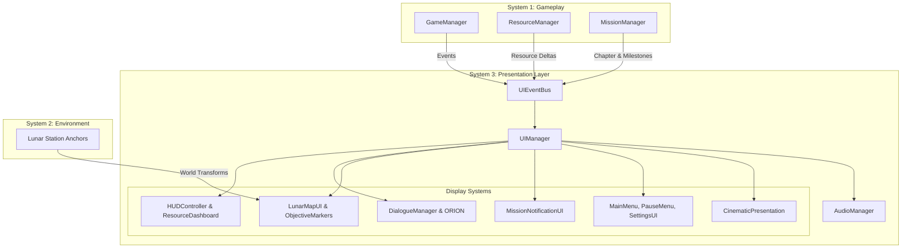
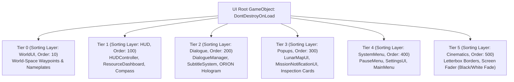

# OUTPOST: SURVIVE BEYOND EARTH
## SYSTEM 3 – UI AND PRESENTATION MASTER ARCHITECTURE
**Project**: Outpost: Survive Beyond Earth  
**Development Target**: Mission 1 – The First Frontier (Lunar South Pole, 2045)  
**Target Engine**: Unity with URP (Universal Render Pipeline)  
**Platform**: Unity WebGL (Browser-based, Target Audience: Children 7–12)  
**Document**: UI & Presentation Architecture Specification (`Documentation/UIArchitecture.md`)  

---

### 1. Architectural Philosophy & Overview

System 3 owns all player-facing presentation, interface screens, character dialogue systems, the interactive lunar GEO map, ORION AI telemetry visualizations, cinematics, and the centralized audio engine. 

To satisfy the demanding requirements of **Unity WebGL in modern desktop browsers** while ensuring a thrilling, frictionless experience for **children aged 7–12**, the architecture follows four foundational tenets:

1. **Strict Decoupling via Interfaces**: Systems 1 (Gameplay) and 2 (Environment) never touch UI GameObjects directly. Communication occurs exclusively through C# interfaces and the centralized `UIEventBus`.
2. **Sub-Canvas Hierarchy Splitting**: Instead of a monolithic root Canvas, UI elements are segregated across multiple sub-canvases with distinct refresh frequencies. Static elements (HUD frames, banners) never cause dynamic elements (resource dials, text scrollers, markers) to redraw their mesh geometry.
3. **Zero-Allocation Event Pipeline**: All standard UI event notifications pass through pre-allocated structs and cached delegates, completely eliminating Garbage Collection (GC) pauses during active gameplay.
4. **Age-Appropriate Design System**: UI styling utilizes high-contrast color palettes, rounded silhouettes, bold iconography (min font size 20pt on standard 1080p canvas), animated visual confirmations, and educational science tooltips designed for younger learners.



---

### 2. Canvas Hierarchy & Layering Structure

To prevent costly Canvas rebuilds in WebGL, the user interface is organized into five isolated render tiers using the **uGUI Canvas Scaler** configured for *Scale With Screen Size* (`Reference Resolution: 1920x1080, Match: 0.5 Width/Height`).



---

### 3. Comprehensive Specifications for the 15 Core Systems

#### 1. MainMenuUI
- **Class**: `Outpost.UI.Menus.MainMenuUI`
- **Role**: Entry point for young players launching Mission 1.
- **Components**:
  - Mission Launch button ("START MISSION 1: THE FIRST FRONTIER").
  - Crew dossier viewer (visual introduction to Elena, Marcus, Aisha, Daniel, and ORION).
  - Audio/Video Settings button and Mission Chapter select (unlocked through gameplay).
  - Engaging background camera movement overlooking the 2045 Lunar South Pole base.

#### 2. HUDController
- **Class**: `Outpost.UI.HUD.HUDController`
- **Role**: Coordinates the in-game heads-up display.
- **Components**:
  - Crosshair & interaction reticle (changes state when hovering over interactables: inspect, repair, talk).
  - Compass bar along the top edge showing cardinal directions and pinned objective bearings.
  - Active Objective display banner with step-by-step guidance for younger players.
  - Quick-key prompts (`[M] Map`, `[TAB] Resources`, `[E] Interact`, `[ESC] Pause`).

#### 3. ResourceDashboard
- **Class**: `Outpost.UI.HUD.ResourceDashboard`
- **Role**: Real-time life-support and station utility telemetry.
- **Visual Meters**:
  - **Oxygen ($O_2$)**: Level percentage, generation rate (electrolysis from ice), status indicator.
  - **Power ($kW$)**: Solar battery reserves, solar array generation, station consumption.
  - **Water ($H_2O$)**: Recycled water reserves, hydroponic consumption rate.
  - **Atmosphere ($CO_2$)**: Scrubbing status, parts-per-million indicator (critical in Chapter 4 & 5 emergency).
  - **Habitat Temperature**: Thermal control loops ($21^\circ C$ nominal).
- **Educational Overlay**: Clicking any resource displays an ORION animated educational popup explaining how real lunar bases generate oxygen and scrub carbon dioxide.

#### 4. DialogueManager
- **Class**: `Outpost.UI.Dialogue.DialogueManager`
- **Role**: Core orchestration engine for all in-game speech and narrative interaction.
- **Capabilities**:
  - Drives two-character and multi-character conversations.
  - Handles branching player dialogue choices with instant visual selection feedback.
  - Provides typewriter text delivery with adjustable speed (accessible reading speed default: 35 chars/sec for kids).
  - Fires completion events to advance mission goals and chapter triggers.

#### 5. ConversationSequenceManager
- **Class**: `Outpost.UI.Dialogue.ConversationSequenceManager`
- **Role**: Manages complex pre-scripted multi-character briefings, automatic scene dialogues, and radio chatter.
- **Capabilities**:
  - Chains multiple `DialogueLine` nodes with customizable inter-line pauses.
  - Allows autonomous crew-to-crew interactions independent of player movement (e.g., Marcus joking with Aisha while Elena briefs the team).
  - Pre-event briefings (e.g., Commander Elena alerting the crew prior to Chapter 3 solar storm).

#### 6. CharacterDialoguePresentation
- **Class**: `Outpost.UI.Dialogue.CharacterDialoguePresentation`
- **Role**: Visual portrayal of speakers during active conversations.
- **Components**:
  - 2D character portrait with emotion swatches (Neutral, Concerned, Determined, Happy, Serious, Alert).
  - Color-coded character name badge:
    - **Commander Elena**: Royal Navy Blue (`#1E56A0`)
    - **Engineer Marcus**: Solar Amber / Orange (`#F68820`)
    - **Scientist Aisha**: Lunar Cyan / Teal (`#00A896`)
    - **Medical Officer Daniel**: Compassion Emerald (`#2E8B57`)
    - **ORION AI**: Holographic Neon Cyan (`#00F5FF`)
  - Subtle breathing and head bob animations to keep portraits lively.

#### 7. ORIONInterface
- **Class**: `Outpost.UI.ORION.ORIONInterface`
- **Role**: Visual and vocal embodiment of the Onboard Robotic Intelligence and Operations Network.
- **Components**:
  - Animated pulsing hexagonal holographic avatar (idle pulse, speaking frequency wave, warning strobes).
  - **Alert Level Indicator**:
    - `Green`: Nominal operations.
    - `Yellow`: Caution (solar activity alert, low battery warning).
    - `Red`: Emergency (micrometeoroid impact, life-support failure).
  - Audio synthetic chime and friendly vocal chirp synthesizer.
  - "Ask ORION" quick educational question drawer available at any time.

#### 8. MissionNotificationUI
- **Class**: `Outpost.UI.Notifications.MissionNotificationUI`
- **Role**: Dispatches non-intrusive toast messages and emergency banners.
- **Message Types**:
  - `ObjectiveUpdate`: Friendly checkmark animation with next task description.
  - `Discovery`: Educational milestone card (e.g., "Discovered Lunar Ice Deposit!").
  - `EmergencyAlert`: Pulsing high-priority warning banner across screen top.
  - `RadioChatter`: Quick one-line ambient subtitle from base speakers.

#### 9. LunarMapUI
- **Class**: `Outpost.UI.Map.LunarMapUI`
- **Role**: Fullscreen interactive tactical and geological map of the Lunar South Pole outpost.
- **Components**:
  - High-resolution topographical grid matching real Unity environment coordinates.
  - Smooth pan (drag / WASD) and zoom (mouse scroll / touch pinch / +/- buttons).
  - Location selection drawer displaying scientific summary and facility status.
  - Real-time player position cursor with directional heading cone.
  - Objective waypoints, route breadcrumbs, and fast-orient "Focus On Player" button.
  - Visited vs Unvisited area fog.

#### 10. ObjectiveMarkerUI
- **Class**: `Outpost.UI.HUD.ObjectiveMarkerUI`
- **Role**: In-world and screen-edge objective compass indicators.
- **Capabilities**:
  - Projects 3D world targets onto 2D screen space with clamping to screen boundaries when off-camera.
  - Displays target icon, name, and exact distance in meters ($m$).
  - Animated pulsing ping when an objective updates.

#### 11. PauseMenu
- **Class**: `Outpost.UI.Menus.PauseMenu`
- **Role**: Clean, child-friendly in-game pause screen.
- **Components**:
  - Resume Game, Settings, Mission Objectives review, and Return to Main Menu.
  - Pauses game time (`Time.timeScale = 0`) safely without breaking UI audio or animations.

#### 12. SettingsUI
- **Class**: `Outpost.UI.Menus.SettingsUI`
- **Role**: Comprehensive accessibility and hardware configuration panel.
- **Sliders & Toggles**:
  - Master Volume, Music Volume, Sound Effects Volume, Voice Volume.
  - Subtitles Toggle (Default: Enabled) and Text Size Selector (Normal, Large, Extra Large).
  - Quality Presets (Optimized for low-spec Chromebooks up to gaming PCs).
  - High Contrast UI Mode (ideal for young readers).

#### 13. CinematicPresentation
- **Class**: `Outpost.UI.Cinematics.CinematicPresentation`
- **Role**: Letterboxing and cinematic fades during chapter introductions and endings.
- **Components**:
  - Smooth vertical black letterbox bars ($2.39:1$ widescreen cinema feel).
  - Camera screen fader (smooth fade to black, fade from black, warning flash).
  - Chapter title splash cards (e.g., "CHAPTER 1: ARRIVAL ON THE MOON").

#### 14. SubtitleSystem
- **Class**: `Outpost.UI.Dialogue.SubtitleSystem`
- **Role**: Accessible subtitles for all radio chatter, ORION announcements, and character speech.
- **Features**:
  - Speaker name tag with character color badge.
  - High-legibility font with solid drop-shadow / dark backing pill for readability against bright lunar terrain.
  - Closed captioning sound descriptors (e.g., *[Alarm blaring]*, *[Radio static]*).

#### 15. AudioManager
- **Class**: `Outpost.UI.Audio.AudioManager`
- **Role**: Centralized WebGL-optimized audio manager.
- **Capabilities**:
  - Cross-fading background music (BGM) tracks (Peaceful Lunar Ambience $\to$ Tense Emergency Theme).
  - 16-channel pooled 2D/3D SFX audio sources to prevent WebGL memory thrashing.
  - UI audio feedback for button clicks, hover chimes, tab switches, and error alerts.
  - Radio squelch / walkie-talkie audio filter for astronaut comms.

---

### 4. Cross-System Collaboration Interfaces

To ensure zero conflicts between Systems 1, 2, and 3:

```csharp
namespace Outpost.Core.Interfaces
{
    // Interface provided by System 3 for System 1 (Gameplay) to update resources
    public interface IResourceDisplay
    {
        void UpdateOxygen(float current, float max, float deltaRate);
        void UpdatePower(float current, float max, float deltaRate);
        void UpdateWater(float current, float max, float deltaRate);
        void UpdateCarbonDioxide(float currentPpm, bool isScrubberActive);
    }

    // Interface provided by System 3 for System 1 to trigger dialogue
    public interface IDialogueService
    {
        void PlayConversation(string conversationId, System.Action onComplete = null);
        void ShowNotification(string title, string message, NotificationType type);
    }

    // Interface provided by System 3 for System 1 to control objectives on Map & HUD
    public interface IMapService
    {
        void SetObjectiveWaypoint(string objectiveId, Vector3 worldPosition, string title);
        void ClearObjective(string objectiveId);
        void UnlockLocation(string locationId);
    }

    // Interface provided by System 1 for System 3 when the player chooses an emergency action
    public interface IEmergencyChoiceHandler
    {
        void OnEmergencyRepairChosen(EmergencyRepairOption option);
    }
}
```

---

### 5. WebGL Performance Budget & Execution Rules

1. **Draw Call Budget**: Total UI draw calls shall not exceed **12 draw calls** in any state. All icons and UI elements share a single Master UI Sprite Atlas (`Outpost_UI_Atlas.png`).
2. **Text Rendering**: Exclusively utilizes Unity TextMeshPro with dynamic SDF font atlases.
3. **No Dynamic Garbage Allocations**: Text strings for resource values use pre-allocated character buffers and value caching to prevent GC allocations on every frame.
4. **Clean Input Handling**: Directly uses the new Unity Input System (`com.unity.inputsystem`) action callbacks rather than legacy `Input.GetKeyDown()` polling in `Update()`.
